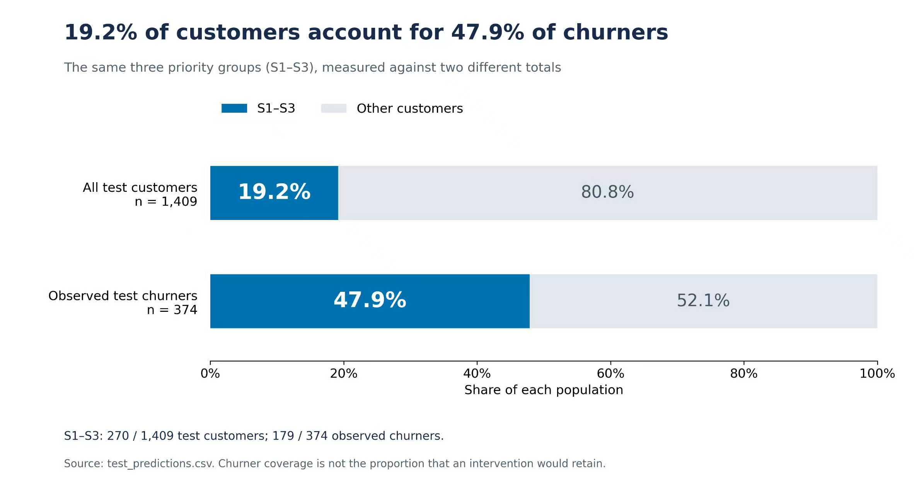

# IBM Telco Customer Retention

A Python project exploring customer churn and retention opportunities using 7,043 records from the [IBM Telco Customer Churn dataset](docs/data_source.md).


## 
## What we did

- Audited and cleaned the data, handling 11 blank `TotalCharges` values while retaining every customer.
- Explored churn patterns across contracts, services, tenure and charges.
- Trained an interpretable decision tree and used its leaf rules to define three priority customer groups.
- Profiled those groups and proposed tailored support packages with a 60-day A/B testing plan.

The three priority groups represent **19.2% of test customers** and contain **47.9% of observed test churners**.



## Explore the repository

- [Data](data/) · original and cleaned customer records.
- [Notebooks](notebooks/) · data audit, cleaning and exploratory analysis.
- [Scripts](scripts/) · reproducible workflows, validation checks and decision-tree modelling.
- [Analysis](reports/eda/eda.md) and [figures](reports/figures/) · findings and customer-group illustrations.
- [Documentation](docs/) · data sources, field definitions and validation notes.

## Run locally

From the repository root, audit and clean the data with Python 3.10 or later:

```bash
python3 scripts/audit_data.py
python3 scripts/clean_data.py
python3 scripts/verify_cleaning.py
```

To train the model, use Python 3.12:

```bash
python3.12 -m venv .venv-model
source .venv-model/bin/activate
python -m pip install -r requirements-model.txt
python scripts/model_decision_tree.py
```

Model outputs are saved to `reports/model/`, which is gitignored. For EDA, use [requirements-eda.txt](requirements-eda.txt) in a separate environment, then run `scripts/eda.py` and `scripts/verify_eda.py`.

*This academic project uses a fictional telecom dataset. The findings describe associations, and the proposed retention actions still need experimental evaluation.*
