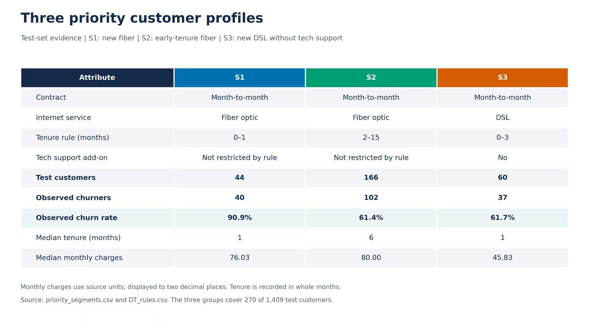
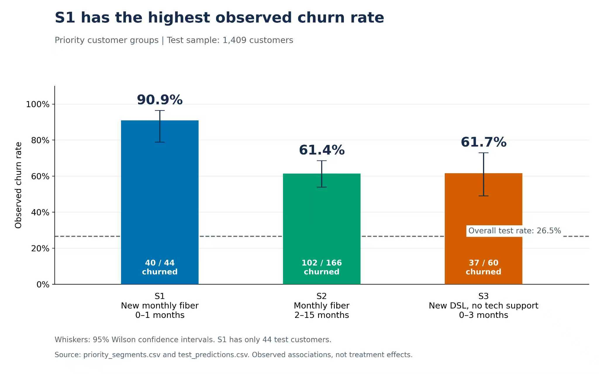
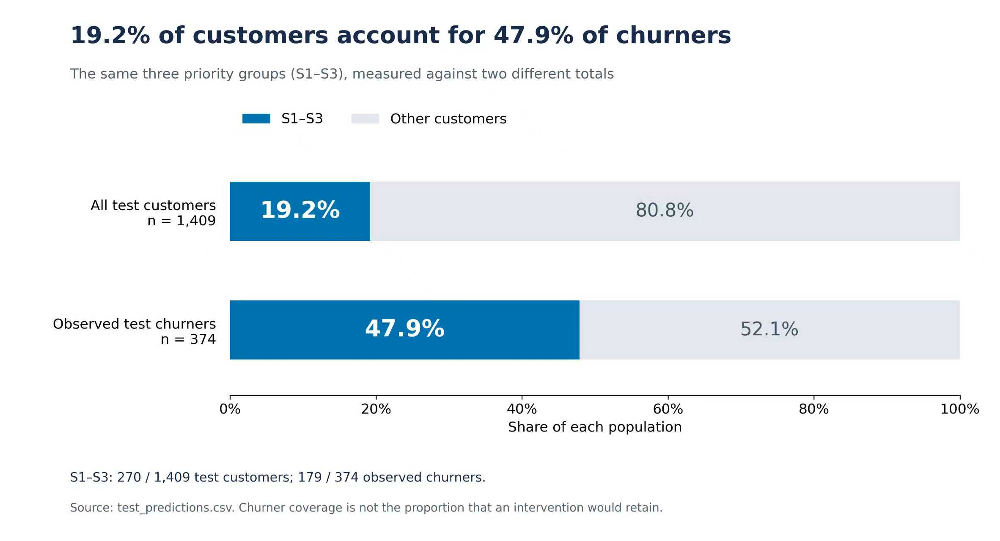
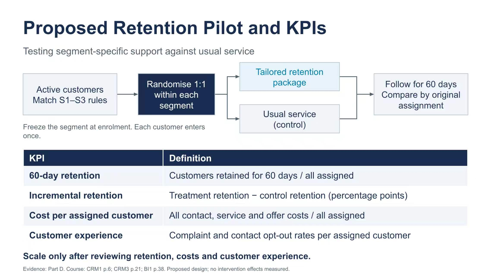

# From Churn Risk to Retention Pilots

**A BI-Enabled CRM Strategy for a Telecom Provider**

COMP3134 Business Intelligence and CRM | Academic group project

This project connects **data preparation, exploratory analysis, interpretable decision-tree modelling, customer profiles and proposed retention experiments**. Using 7,043 IBM Telco customer records, we turn churn-related patterns into explicit group rules and a plan for testing differentiated support.

**Key finding:** three priority groups contain **270 of 1,409 test customers (19.2%)** and **179 of 374 observed test churners (47.9%)**. This supports focused investigation; it does not measure how many customers a campaign would retain.

## 1. Problem

A telecom provider needs to decide where to focus limited retention resources and which actions to evaluate. An overall churn rate alone does not identify actionable combinations of customer characteristics.

We ask:

- Which customer, service and account characteristics are associated with churn?
- Can a decision tree define higher-risk groups through clear rules?
- How do these groups differ in size, observed churn and billing characteristics?
- Which retention packages should be tested, and how should effectiveness be measured?

The intended output is an auditable link from **customer records → decision rules → priority profiles → retention pilots**.

## 2. Data

We use the public [IBM Telco Customer Churn dataset distributed on Kaggle](https://www.kaggle.com/datasets/blastchar/telco-customer-churn), a fictional telecom teaching sample with **7,043 customers and 21 original fields**. `Churn` is the binary target; the full-sample churn proportion is **26.5%**.

- Preserve the original CSV and record SHA-256 checks for traceability.
- Audit missing values, duplicates, category domains and service relationships.
- Convert 11 whitespace-only `TotalCharges` entries to missing values and add `TotalChargesMissing`. Missing charges are not replaced with zero.
- Retain every customer; the cleaned dataset contains 22 fields, including the added indicator.

See the [data source](docs/data_source.md), [data dictionary](docs/data_dictionary.md), [audit report](reports/audit/audit.md) and [cleaning report](reports/cleaning/cleaning.md).

## 3. Analysis

### Exploratory analysis

Six figure sets and supporting tables examine churn distribution, numerical characteristics, contracts, internet service, service subscriptions and correlations.

Full-sample descriptive comparisons include:

- **Contract:** observed churn is 42.7% for month-to-month, 11.3% for one-year and 2.8% for two-year contracts.
- **Internet service:** observed churn is 41.9% for fibre, 19.0% for DSL and 7.4% for customers without internet service.

These are separate category comparisons, not joint customer profiles or causal effects. See the [EDA report](reports/eda/eda.md) and [figures](reports/eda/figures/).

### Decision-tree modelling

The tree uses **churn status as its target** and partitions customers through combinations of attributes. Each path becomes a readable rule; each leaf contains customers sharing that rule. Training-set churn proportions identify priority leaves for profiling.

- **Inputs:** 18 original predictors covering customer profiles, subscriptions and account information. Exclude `customerID`, `Churn`, `TotalCharges` and the added missingness indicator from the cleaned dataset.
- **Split:** stratified 60% training / 20% validation / 20% testing; 4,225 / 1,409 / 1,409 customers; random seed 42.
- **Preprocessing:** training-fitted imputation and one-hot encoding within a pipeline.
- **Selection:** five-fold training cross-validation using average precision, comparing depths 2–4 and minimum leaf sizes of 50, 100 and 200.
- **Selected tree:** maximum depth 4, at least 100 training customers per leaf, and 15 fitted leaves.
- **Group selection:** choose three leaves by training churn proportions, without test labels. Apply the frozen rules to the test split for profiling.
- **Classification threshold:** selected separately using validation F1, approximately 0.335. It changes predicted classes, not leaf membership.

At that threshold, test-split **ROC-AUC is 0.826**, **average precision 0.600**, precision 53.8%, recall 69.3%, F1 0.606 and accuracy 76.1%. The model identifies 259 of 374 observed churners and flags 222 non-churners. An always-no-churn baseline already achieves 73.5% accuracy, so accuracy alone is insufficient.

Twenty training-subsample refits assess sensitivity of the fixed specification. Contract, tenure, internet service and monthly charges recur in every refit, while mean group-membership Jaccard overlap is approximately 0.64–0.70. Broad patterns recur, but exact boundaries vary.

## 4. Customer Profiles and Insights

The priority groups are mutually exclusive tree leaves, rather than K-means clusters:

- **S1 — New monthly fibre:** month-to-month contract, fibre internet, tenure 0–1 months. **40/44** test customers churned (**90.9%**).
- **S2 — Early-tenure monthly fibre:** month-to-month contract, fibre internet, tenure 2–15 months. **102/166** churned (**61.4%**).
- **S3 — New monthly DSL without the support add-on:** month-to-month contract, DSL, tenure 0–3 months and `TechSupport=No`. **37/60** churned (**61.7%**).

S1 and S2 impose no technical-support restriction. `TechSupport=No` means no technical-support add-on; it does not mean general customer service is unavailable.



**S1 has the highest observed rate**, but only 44 test customers; its 95% Wilson interval is 78.8%–96.4%. **S2 has the largest observed churner count.** S2 and S3 have similar rates and overlapping intervals, so their small difference is not a sound basis for ranking them.



Together, the three leaves concentrate observed churn into a smaller share of customers. The remaining leaves still contain **195 churners** and require normal service and continued monitoring.



Monthly charges describe billing, not realised profit, customer lifetime value or demonstrated price sensitivity. These profiles suggest questions for customer research and pilot design; they do not establish why individual customers leave.

## 5. Retention Strategy and Pilot Evaluation

We propose differentiated packages for a **new cohort of active customers** matching the rules:

- **S1:** activation and installation follow-up, connection/device checks, first-use guidance and first-bill explanation.
- **S2:** needs-based plan review and service follow-up; address reported issues before considering a separately costed, capped offer. No blanket discount is assumed.
- **S3:** onboarding guidance, self-help troubleshooting and a clear route to existing human support without requiring purchase of an add-on.

S2 is the proposed main pilot cohort because it contains the largest observed churner count, subject to current eligibility and a new power calculation. S1 and S3 can begin as feasibility studies or recruit longer if underpowered. Historical test counts are not prospective trial sample sizes.

Within each eligible segment, **randomise customers 1:1** to the tailored package or usual service. Freeze membership at enrolment, allow one entry per customer and follow both arms for a proposed **60 days**. Analyse by original assignment, including customers who decline or cannot be reached, and document missing outcomes. Confirm decision-time attribute availability and permitted contact channels before recruitment.



Prespecified outcomes should include:

- **60-day retention:** customers retained throughout the defined window divided by all assigned customers, with a clear cancellation definition.
- **Incremental retention:** treatment retention minus control retention, in percentage points.
- **Cost per assigned customer:** recorded contact, staff, service and offer costs divided by all assigned customers; compare both arms.
- **Customer experience:** complaint and contact-opt-out rates, unresolved issues, and satisfaction alongside response rates.

Define the smallest worthwhile effect, sample size and cost/experience limits before launch. Scale only after a useful retention effect is demonstrated with acceptable uncertainty and guardrails. **No intervention lift, savings or ROI has been measured.**

## Reports and Repository Guide

The supplied team documents are preserved unchanged:

- [Part D — Customer Profiles and Business Insights](reports/team/part-d-customer-profiles.docx)
- [Part E — Targeted Retention Strategies and Pilot Evaluation](reports/team/part-e-retention-strategy.docx)
- [Integrated project report — supplied draft](reports/team/integrated-project-report.docx), including its existing integration notes and placeholders.

```text
data/raw/              Original dataset and source manifests
data/processed/        Cleaned dataset and schema
docs/                  Data dictionary, decisions, handoff and validation notes
notebooks/             Audit, cleaning and EDA notebooks
scripts/               Reproducible audit, cleaning, EDA and modelling workflows
reports/audit/         Data-quality evidence
reports/cleaning/      Cleaning summary and cell-level change log
reports/eda/           Exploratory tables, report and figures
reports/team/          Supplied team DOCX reports
reports/figures/       Supplied profile, evidence and pilot illustrations
reports/model/         Generated locally by the modelling script; gitignored
```

Some supplied reports refer to an earlier local `code/results/` directory. Here, generate corresponding model outputs under **`reports/model/`**. The script writes `DT_rules.csv`, `DT_profiles.csv`, `priority_segments.csv`, `test_predictions.csv`, `metrics.csv`, stability CSVs, tree/performance figures and `run_info.json`. These generated outputs are not currently tracked. The four embedded illustrations are supplied team assets, rather than additional figures generated by the modelling script.

## Reproduce the Analysis

Clone the repository and run from its root. Audit and cleaning use the Python standard library:

```bash
git clone https://github.com/onoizu/IBMTelecom-Customer-Retention.git
cd IBMTelecom-Customer-Retention
python3 scripts/audit_data.py
python3 scripts/clean_data.py
python3 scripts/verify_cleaning.py
```

Use a separate environment for EDA figure dependencies:

```bash
python3 -m venv .venv
source .venv/bin/activate
python -m pip install -r requirements-eda.txt
python scripts/eda.py
python scripts/verify_eda.py
deactivate
```

The modelling dependencies were tested with **Python 3.12**; keep them separate from EDA:

```bash
python3.12 -m venv .venv-model
source .venv-model/bin/activate
python -m pip install -r requirements-model.txt
python scripts/model_decision_tree.py
```

## Interpretation and Limitations

- This fictional teaching sample is an academic exercise, not a production deployment or partnership with IBM. Observation dates and currency are insufficiently established.
- The dataset does not support true calendar-cohort analysis or a validated prospective 60-day churn baseline.
- Earlier exploration had already examined the test split. Reported metrics are exploratory evidence, not a fresh, untouched final evaluation.
- Tree rules describe associations, not causes, calibrated individual future-risk estimates or intervention benefits.
- Small groups and varying boundaries require reassessment on new, time-stamped data. Higher observed churn alone does not establish greater treatment benefit or profitability.

The project contributes an interpretable targeting workflow and a measurable pilot proposal. Prospective validation and randomised evaluation are the next steps before operational rollout.
